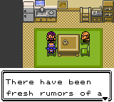
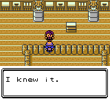
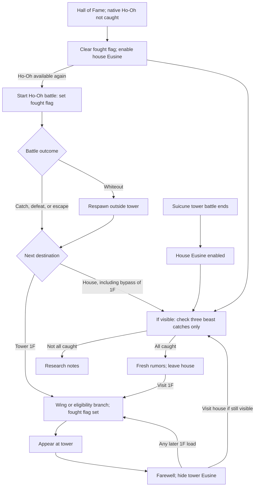
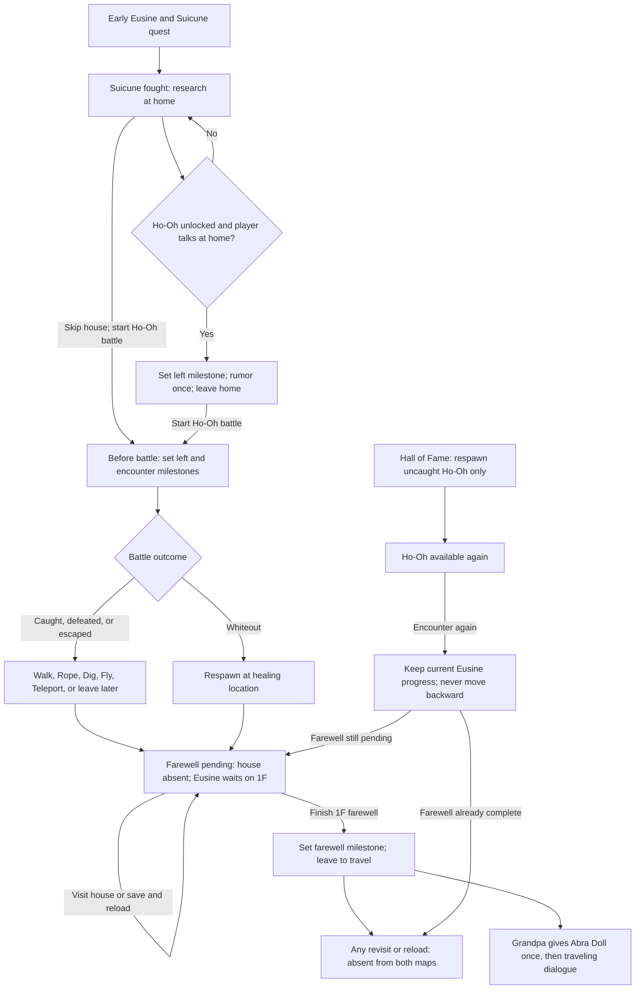

Eusine event order investigation and proposed fix
===============================================

Issue [#1282](https://github.com/Rangi42/polishedcrystal/issues/1282) is reproduced on branch `investigate/1282-eusine-event-order`, based on `0e73a0d5f13b4cc97d924c17ee2e239f20318aef`. The investigation below records the original bug and approved design. Implementation was subsequently authorized; see [save patcher integration](SAVE_PATCHER.md) and [validation](VALIDATION.md) for the current implementation and release handoff.

The proposed fix separates Eusine's permanent story progress from Ho-Oh's repeatable encounter availability. Completing his farewell must permanently prevent both the house rumor and tower farewell from replaying. Leaving by whiteout or a field move must preserve a farewell that has not yet been heard.

**Reproduction and evidence**

The unmodified normal ROM ran in the core from `../vibeEmu`, revision `b7938e412584e2dfa6385eaa27b331533a2e543a`. The reproduction sets a controlled post–Ho-Oh state once, then lets normal map callbacks, dialogue, and NPC movement execute. Debugger warps replace travel between locations; this is not a new-game-to-Ho-Oh playthrough. The catch and Elite Four prerequisites are fixture inputs, not battles performed during this run.

Inputs:

- ROM: `polishedcrystal-3.2.3.gbc`, SHA-256 `ef817cc46ba506662af35781860320b2419135d115496d4853ab4fa789588af0`.
- Existing local seed: `polishedcrystal-debug-3.2.3.sav`, save version 11, SHA-256 `94dbfa619fc628778a621bdd30454321a70a6fafba3802ba4880b118da164b04`.
- The seed is loaded into memory and never saved back. The driver verifies that ROM, symbol, and save file hashes remain unchanged. Neither a ROM nor the user's save is included in the deliverable.
- Controlled flags: Elite Four complete; all three native beast catches; Suicune scene complete; Rainbow Wing received; Ho-Oh fought and caught; Eusine initially available at home and hidden at the tower. The tower callback itself then makes him appear.

Observed sequence:

| Step | Observation | Tower hidden bit | House hidden bit |
| --- | --- | --- | --- |
| Load 1F after the encounter | Eusine appears and starts his farewell | 0 | 0 |
| Finish the complete farewell and departure movement | Eusine disappears; script returns to idle | 1 | 0 |
| Enter the house and talk to him | He announces fresh Ho-Oh rumors despite the completed farewell | 1 | 0 |
| Finish the house departure | House Eusine disappears | 1 | 1 |
| Return to 1F | Callback restores Eusine; the same farewell starts again | 0 | 1 |
| Finish again, visit 2F, return to 1F without visiting Celadon | Eusine reappears again | 0 | 1 |

Here, a set object event bit means hidden. These are actual runtime assertions, not inferred outcomes. The same farewell was visually inspected on both appearances.





Run the reproduction against a ROM and symbols built from the baseline commit (the fixed ROM intentionally fails these bug assertions):

```sh
python3 docs/issue-1282/reproduce.py --rom /path/to/baseline.gbc --sym /path/to/baseline.sym
```

The driver uses the sibling vibeEmu source directly through a temporary Cargo project. It requires Rust, cached Cargo dependencies, and Pillow. The default seed is the existing local save identified above; another seed may need different title/Continue input timing. `--rom`, `--sym`, `--save`, and `--output` override inputs and output location. Outputs default to `/tmp/issue1282-replay`. Retained evidence includes [the command sequence](evidence/commands.txt), [the assertion trace](evidence/trace.txt), and [input hashes](evidence/inputs.json). The driver asserts the broken baseline. The separate `verify.py` driver asserts the fixed behavior.

**Why it happens**

1. [TinTower1FNPCsCallback](../../maps/TinTower1F.asm) calls `appear` whenever `EVENT_FOUGHT_HO_OH` is set, once the Rainbow Wing/progression branch is reached. The farewell only calls `disappear`; no separate completion flag prevents the next map load from undoing it.
2. [CeladonEusine](../../maps/EusinesHouse.asm) checks only `SpecialBeastsCheck` before the rumor/departure branch. It does not check the Ho-Oh encounter or the farewell. The house has no callback to reconcile its visibility with later story progress.
3. [RespawnOneOffs](../../engine/events/specials.asm), called at every successful Hall of Fame entry, clears both `EVENT_FOUGHT_HO_OH` and the house's hidden bit whenever native Ho-Oh has not been caught. Thus a repeatable battle flag also controls a supposedly permanent story. This happens on the first Elite Four victory too, even if Suicune's tower scene has not happened.
4. [TinTowerHoOh](../../maps/TinTowerRoof.asm) sets the fought flag before battle. [reloadmapafterbattle](../../engine/overworld/scripting.asm) jumps into the whiteout script on loss and does not continue to the remaining encounter commands. A new persistent encounter milestone placed after that command would miss losses.
5. Grandpa currently combines house visibility, fought-Suicune, the Abra Doll, and the resettable fought-Ho-Oh bit. Consequently, dialogue/reward access can depend on which map was visited rather than on story progress.

**Before flowchart**



The 1F eligibility branch is `GOT_RAINBOW_WING` or `(BEAT_ELITE_FOUR and SpecialBeastsCheck)`. Optional exits and repeated visits expose the same missing completion state; the house conversation is not required for the tower replay.

**Proposed story states**

Use three permanent event bits, tentatively `EVENT_EUSINE_LEFT_CELADON`, `EVENT_EUSINE_HO_OH_ENCOUNTER`, and `EVENT_EUSINE_HO_OH_FAREWELL`. They form a monotonic four-state sequence; they are never cleared by legendary respawns. Existing visibility bits become outputs of these states, not evidence that a conversation happened.

| State | New bits: left, encounter, farewell | House | Tower 1F | Grandpa |
| --- | --- | --- | --- | --- |
| Early quest | 000, Suicune not yet fought | Absent | Original Suicune scene rules | Searching for Suicune |
| Research | 000, Suicune fought | Present | Absent outside Suicune cutscene | Grandson home |
| Departed for Ecruteak | 100 | Absent | Absent until Ho-Oh encounter | Visiting Bell Tower |
| Farewell pending | 110 | Absent | Present | Still visiting Bell Tower |
| Farewell complete | 111 | Absent | Absent | One-time Abra Doll, then traveling |

The research-to-departure conversation is optional. Starting Ho-Oh's battle advances either research or departed state to farewell pending. There is no prerequisite to visit Celadon. The rumor is available only while still researching and Ho-Oh is actually unlocked: `GOT_RAINBOW_WING` or `(BEAT_ELITE_FOUR and all three native beast-caught flags)`. Before that, retain the research notes; when the beasts are caught but the League condition is missing, use a short waiting/research line rather than a false appearance rumor.

The three bits avoid dependence on a resettable encounter flag and avoid overloading object visibility. Allocate them in three audited unused event slots without changing any existing event number, `NUM_EVENTS`, or SRAM size. Old values in those slots must be explicitly initialized during migration. Verify the exact slots against supported release layouts before choosing them.

**After flowchart**



Exit availability is map-specific, as detailed below. The graph groups exits because none should change the story state. Standalone rendered deliverables: [before flowchart](before.svg) and [after flowchart](after.svg); their editable Graphviz sources are [before.dot](before.dot) and [after.dot](after.dot).

**Approved implementation steps**

1. Reserve and initialize the three event bits, establish the state precedence `farewell > encounter > left > research/early`, and implement one small shared resolver for the house, 1F, and Grandpa. Both object callbacks must explicitly set their object's visible/hidden result on every normal map-entry path. Keep the Suicune cutscene's temporary Eusine appearance separate from his post–Ho-Oh standing NPC. Do not let the sage/beast eligibility branches bypass the Eusine resolver. Continue deliberately restores saved objects and skips `LoadMapObjects` / `MAPCALLBACK_OBJECTS` in this engine; therefore update live objects and saved visibility consistently at each story transition, and convert legacy saves only from a neutral location. Verify Continue directly rather than assuming it reruns the callback. Do not globally rerun unrelated map callbacks on Continue.
2. At `CeladonEusine`, guard the rumor with the persistent state and unlock condition. Commit the left milestone once the departure text is acknowledged, before the departure movement. Keep the player-step-aside behavior and test each accessible facing. No additional permanent milestone is needed merely for reading beast notes.
3. At `TinTowerHoOh`, set left and encounter milestones immediately before `startbattle`, alongside the existing fought flag. Never clear farewell if it was already set. Preserve existing battle results, catch tracking, roof sprite behavior, and Ho-Oh respawning.
4. In `TinTower1FEusineAfterHoOhScript`, commit farewell after the text is acknowledged and before exit movement. Reconcile both location flags; use `disappear` for the loaded tower object. Future callbacks must keep him absent. If a stale object invokes this script after completion, end without replaying the farewell and reconcile its visibility.
5. Remove Eusine's house reset from the Ho-Oh branch of `RespawnOneOffs`. That routine should control Pokémon availability only. Preserve the existing Suicune postbattle home transition, including loss: its progression writes occur before `reloadmapafterbattle`. Reconcile the home output with any later Eusine milestone instead of unconditionally reopening an earlier stage.
6. Make Grandpa read the same story state, with the reward bit independently preventing duplicate gifts. Recommended reward timing: after the tower farewell, when Eusine has actually asked the player to visit Grandpa. A migrated existing doll remains owned and is never re-awarded. This intentionally removes the current ability to get the doll before the farewell on some visit orders.
7. Audit late returns to Burned Tower, Cianwood, Route 36, and Route 42. Preserve the original early quest, including Cianwood wins/losses and skipped optional sightings; completed Suicune progression must not reopen an earlier Eusine appearance. If a reachable stale early appearance is found, add the smallest progression guard without inventing a new battle win or rewinding a beast scene.
8. Document the agreed conversion for the external v3.3.0 save patcher without another version bump, then run the scenario matrix below in vibeEmu. The user approved the game implementation and requested the patcher handoff rather than changes to that repository.

**Coverage of event orders and exits**

The matrix records the approved requirements. It is not a claim that every row was played end to end; [VALIDATION.md](VALIDATION.md) distinguishes emulator checks from source-reviewed behavior and remaining external patcher validation.

| Scenario or ordering | Required behavior / test |
| --- | --- |
| Before beast release; before or after the first Burned Tower talk | Original early quest remains available. No premature home/tower farewell NPC. |
| Skip the basement talk; visit Cianwood before or after sightings | Original relocation works; returning to early maps cannot revive an obsolete appearance. |
| Win or lose to Eusine in Cianwood | Existing consumed-event behavior remains; loss must not duplicate the battle or relocate late-stage Eusine backward. |
| Skip Cianwood encounter, Route 36 sighting, or Route 42 sighting before Suicune | Suicune's existing scene cleanup remains authoritative; visiting those places later does not restart the sequence. |
| Fight Suicune before or after Elite Four | Home research becomes available after Suicune; Hall of Fame alone must not fabricate that story transition. |
| Catch, knock out, run from, or white out against Suicune | Existing consumed Suicune scene and home research persist; only native catch sets the caught condition. A loss skips celebration text but cannot strand the home phase. |
| Fail Suicune; Hall of Fame respawns roaming Suicune; catch it later | Completing the final native beast catch can unlock Ho-Oh; no reset of Eusine's later milestones. |
| Zero, one, two, or three beast catches, in any species order | Missing-beast research follows the caught mask. All eight masks are checked. |
| Catch all beasts before League, or beat League before catching the last beast | Same eventual eligibility. No premature rumor before Ho-Oh unlocks. |
| Beasts in PC, daycare, traded away, or released after native catch | Use existing native-catch flags, not party contents or Pokédex ownership. Beast release/roaming respawn must not rewind the story. |
| Receive traded beasts or traded Ho-Oh without native catch | Do not use traded ownership as a native encounter/catch milestone. Trading alone does not unlock this story. |
| Visit house before eligibility, after eligibility, after Wing, or never | Notes remain repeatable as appropriate; departure rumor at most once; house visit never gates Ho-Oh or farewell. |
| Leave house immediately without speaking | No departure milestone. Once Ho-Oh is encountered, skip the obsolete rumor regardless. |
| Leave after departure rumor, before collecting Wing or approaching Ho-Oh | Preserve departed state through travel and saves; no farewell before an encounter. Grandpa correctly says visiting Bell Tower. |
| Climb tower, see roof, and leave without initiating battle | No encounter milestone; looking at a sprite is not the battle trigger. |
| Ho-Oh catch | Pending farewell remains until acknowledged; no Ho-Oh respawn. |
| Ho-Oh KO, player escape, or another non-catch battle termination allowed by the engine | Pending farewell remains; existing Ho-Oh respawn rules are unchanged. Include full-box/catch-failure paths rather than treating every ball attempt as a catch. |
| Whiteout in Ho-Oh battle | Encounter milestone already committed before battle. House stays absent; farewell waits on 1F despite script termination. |
| Whiteout elsewhere in the tower before Ho-Oh, after Ho-Oh, or after farewell | Before: no advance. After: pending persists. Completed: never reopen. |
| Overworld poison damage | This build heals poison at 1 HP; do not invent an ordinary poison-faint route. If the generic overworld-whiteout handler is reached, apply the same state-preservation rule. |
| Walk down stairs, use internal tower warps, or leave through the entrance | Map callbacks produce the same state on every load. Simply passing 1F does not complete a farewell. |
| Escape Rope or Dig from floors 1–10 | Allowed for their `DUNGEON` environment with valid recorded Dig warp. Destination bypasses the farewell; state persists. Test correct entrance destination, canceled/failed use, and no item consumed on failure. |
| Escape Rope or Dig directly on roof | Roof is `INDOOR`, below the diggable environment threshold: use fails and progress does not change. Descending to 10F then escaping is a valid bypass. |
| Fly or Teleport from roof | Roof is explicitly in `IndoorFlyMaps`; normal move/destination requirements still apply. Successful exit bypasses 1F, preserving pending farewell. Canceled menu/invalid destination changes nothing. |
| Fly or Teleport from floors 1–10 or Eusine's house | These interiors are not exceptions in `IndoorFlyMaps`; failed use has no story effect. Fly/Teleport after walking outdoors also preserves progress. |
| Go directly to Celadon after Ho-Oh, bypassing 1F | Eusine absent at home; Grandpa points to Bell Tower; later visit still delivers the farewell once. |
| Visit 1F, ignore Eusine, and leave | Farewell remains pending. Re-enter from either the trail or upstairs. |
| Complete farewell before ever visiting house | Both locations stay empty on subsequent visits. Grandpa gift remains obtainable. This is the issue's primary order. |
| Complete farewell after having heard the house rumor | Same final state, independent of the earlier visit. |
| Repeated 1F entry, house entry, Continue, or map callback after farewell | Never repeat either conversation or return him to an earlier location. |
| Finish Elite Four again before Ho-Oh, while farewell pending, or after farewell | Only uncaught Pokémon respawn. Eusine's milestones remain unchanged in all three orders. |
| Ho-Oh KO/loss, skip farewell, respawn Ho-Oh, encounter again | One pending farewell survives the cleared fought flag; no extra rumor or duplicate pending event. |
| Ho-Oh KO/loss, finish farewell, respawn and catch Ho-Oh later | Completion survives all rematches; no repeated farewell. |
| Save/reload on roof, on 1F with Eusine present, inside house, and after each milestone | Same locations and text as before saving. Continue restores object snapshots rather than running OBJECTS/NEWMAP callbacks; transition writes must leave those snapshots consistent. |
| Reset during text or movement; load an older save | Normal rollback to the last successful save, not artificial progress loss. Ordinary saves cannot interrupt these scripts. Loading an old emulator savestate restores old history; cross-ROM savestates are not migrated. |
| Talk from every reachable side; player obstructs exit; sages nearby | Existing step-aside paths work without stuck movement or advancing the story without finishing text. |
| Grandpa before Suicune, while Eusine is home, departed, pending, complete, and after doll | Dialogue agrees with state; award exactly once and never revoke an existing doll. |
| Legacy save has contradictory object bits, stale scene IDs, or formerly unused bits set | Migration derives a canonical state; visibility bits never overrule a later milestone. Retain valid early scene progression. |

Sources for exit constraints: [field moves](../../engine/events/overworld.asm), [environments](../../data/maps/maps.asm), [indoor Fly exceptions](../../data/maps/indoor_fly_maps.asm), [Dig destination recording](../../engine/overworld/warp_connection.asm), [whiteout](../../engine/events/whiteout.asm), and [poison steps](../../engine/events/poisonstep.asm).

This reduces unbounded visit orders to a finite set of progression states plus exits that preserve them. The regression driver enumerates every combination of the three new bits, old encounter/catch bits, beast-caught mask, League/Wing prerequisites, Suicune progression, doll ownership, and visibility bits. Verify the resolver's precedence and idempotence, and then exercise reachable representatives in vibeEmu. Invalid combinations are migration/defensive-input cases, not invented gameplay routes. The key invariants are: no story regression, no two standing Eusines, no lost pending farewell, no duplicate reward, and unchanged legendary availability.

**Save migration and the unavoidable legacy ambiguity**

The v3.3.0 version bump has already happened. Per the implementation approval, keep `SAVE_VERSION = 11` and document the Eusine conversion in the external patcher's existing released-v10-to-v11 migration. No additional bump or standalone converter is needed. The exact integration, IDs, inference policy, and tests are in [SAVE_PATCHER.md](SAVE_PATCHER.md). That handoff supersedes the investigation's original patcher/version assumptions.

Old saves cannot prove that the farewell happened. `EVENT_TIN_TOWER_1F_EUSINE = 1` can mean it just finished, or that the player escaped/whited out without ever entering 1F. Its clear value can mean the callback ran, even after an earlier farewell. A later Hall of Fame visit can also erase the only fought-Ho-Oh evidence after an uncaught encounter. No heuristic can reconstruct all these histories exactly.

Approved migration policy:

| Legacy evidence, in priority order | Canonical migrated state |
| --- | --- |
| Abra Doll already awarded | Farewell complete; keep doll. This is an outcome-preservation policy, not proof the old farewell was heard. |
| Native Ho-Oh caught, or current fought-Ho-Oh set | Farewell pending; permanently suppress the obsolete house rumor, but preserve a chance to hear the farewell and unlock the reward. |
| Neither above; Suicune fought, house hidden, and Ho-Oh eligibility established | Departed for Ecruteak. No fresh rumor. |
| Suicune fought, no later evidence | Research at home. |
| Suicune not fought, no later evidence | Early quest; remove any accidental premature house visibility created by Hall of Fame. |

This default can permit **one farewell replay on an ambiguous old save** that had already heard it; every subsequent farewell is recorded correctly. If an old failed Ho-Oh encounter was erased by Hall of Fame, even its historical existence may be unrecoverable, so the converter cannot guarantee suppression of every historical rumor. This limitation applies to legacy conversion, not fresh saves using the new milestones.

Alternative for review: treat native-caught/fought-Ho-Oh legacy evidence as farewell complete. That prevents a legacy farewell replay but skips the farewell for players who escaped or whited out before hearing it; make the doll available so those players lose no reward. Neither default solves erased history. A converter may offer an explicit optional override for users who know they already completed the farewell. Do not silently claim certainty from object visibility. The recommended default prioritizes preserving unseen story content.

Conversion requirements are superseded by the external patcher handoff: preserve its source validation and rejection of invalid checksums/interrupted saves, then perform the new inference before backup/checksum regeneration. Reconcile new milestones and both visibility bits, preserve scene/catch/inventory/party/box data, regenerate coherent primary and backup saves with correct checksums, and update the version last in a separate output file. Keep original bytes untouched; reject already-converted or unsupported versions without applying the conversion again. Test primary-only valid, backup-only valid, both valid but differing, interrupted-save markers, invalid checksums, each legacy branch, existing doll, and unknown reserved-bit values. Use the external patcher's existing neutral location: upstairs in a Pokémon Center near the stairs, followed by its existing NPC cache cleanup.

**Validation and review decisions**

The original investigation passed the automated vibeEmu replay and inspected the first farewell, stale rumor, second farewell, and re-entry-without-house screenshots. Those artifacts remain baseline evidence; the fixed-ROM results and their exact scope are recorded separately in [VALIDATION.md](VALIDATION.md).

For implementation, build normal and faithful variants, run the repository's required assembly optimization check on changes, verify event numbers/SRAM layout and save checksums, and execute the matrix using vibeEmu. Validate the state resolver over all relevant input combinations rather than testing only the happy path. Confirm actual field-move and battle-loss exits in addition to debugger-assisted fixtures; capture save/Continue cases and migrated saves in both variants. Do not require a full emulator regression suite unless the emulator itself is changed.

The approved review choices are: permanent story milestones with no requirement to visit Celadon; Ho-Oh encounter recorded before battle; Grandpa's doll after farewell; and content-preserving migration that may replay one ambiguous legacy farewell. The implementation approval retained these choices and overrode the initial save-version proposal: no additional version bump.
